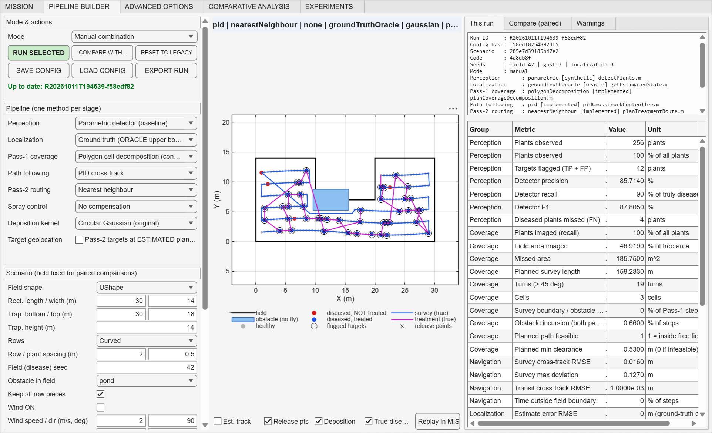

# Manual Pipeline Builder — user guide

## Open it

```matlab
cd('C:\Users\Shraddha.B\Downloads\attachments')
app = AgriculturalDroneDashboardV2;      % then click the PIPELINE BUILDER tab
```



## 1. Choose a combination

**Left panel, "Pipeline":** pick one method per stage:
- perception,
- localization,
- Pass-1 coverage,
- path following,
- Pass-2 routing,
- spray control,
- deposition kernel.

There is also a **Target geolocation** checkbox. Methods marked `(UNAVAILABLE)` cannot be selected; the dropdown springs back to the last valid choice.

**Left panel, "Scenario":** sets the condition, and stays fixed when you compare pipelines:
- field shape: Trapezoid, Rectangle, or the concave UShape,
- sizes, row style and spacing, field seed,
- **obstacle** (none / pond) and **keep all row pieces** (turn this on for UShape or pond, otherwise the legacy generator drops the shorter piece of each split row),
- wind, gust, valve delay, localization seed, speed,
- physics models,
- hardware profile.

**Mode:**
- **Manual combination** runs exactly what you selected.
- **Best fixed** and **Scenario selector** use the saved Experiment F models; they fail closed outside the trained scenarios.
- **Oracle** is hindsight, for research only.

## 2. Run and inspect

Press **RUN SELECTED**. The pending-changes label turns green, "Up to date: <run id>", once the shown run matches the controls.

**Centre map:**
- field, obstacles, plants (true disease status),
- survey and treatment tracks (true positions),
- flagged targets, release points,
- deposition.

Toggle **Est. track** to overlay what the drone believed. **Replay in MISSION** animates this run in the MISSION tab.

**Right side, "This run":**
- run id, hashes, seeds, implementation per stage,
- metric table: perception, coverage, navigation, localization, treatment, spray, routing, resources, feasibility, compute.

The **Warnings** tab lists caveats, for example ORACLE localization, UNCALIBRATED kernel, ineffective choices, dropped row pieces, and hardware feasibility.

## 3. Compare on a paired scenario

1. Run pipeline A.
2. Change **one** stage (for example routing NN → NN + Or-opt) and leave the scenario untouched.
3. Press **COMPARE WITH...** and choose the earlier run(s) (up to 4).

The **Compare (paired)** tab shows each metric side by side with differences. Runs with a different scenario hash (field, seeds, environment, vehicle) are refused as unpaired.

From code:

```matlab
pc = pipelineDefaults(); pc.scenario.wind.enabled = true; pc.pipeline.controller = 'pid';
a = runPipeline(pc);
pc.pipeline.routing = 'nearestNeighbourOrOpt';
b = runPipeline(pc);
T = comparePipelineRuns({a, b})          % errors comparePipelineRuns:unpaired if scenarios differ
```

## 4. Save, load, export

- **SAVE CONFIG** / **LOAD CONFIG** write and read PipelineConfig JSON (schema v1). Unknown fields are ignored and missing fields take the legacy defaults.
- **EXPORT RUN** writes `pipeline_runs/<runId>/`:
  - `config.json` (as run),
  - `requested_config.json` (for saved-model modes),
  - `run_info.json` (hashes, code commit, seeds, implementations, calibration status, warnings),
  - `metrics.csv`,
  - `comparison.csv` when a comparison is open.

  It never writes to `results/`.
- **RESET TO LEGACY** restores the legacy selection. It reproduces the golden baseline mission bit for bit.

## 5. Examples

**Concave field with an obstacle.** Shape `UShape`, obstacle `pond`, keep all row pieces ✓.
- Compare coverage `boustrophedon` against `polygonDecomposition`.
- Legacy crosses the notch and the pond. Decomposition reports 0 % boundary or obstacle violation.
- Decomposition routes Pass-2 legs around the pond.

**GPS-denied.** Localization `sensorFusion`, controller `pid`, Target geolocation ✓.
- Compare against `groundTruthOracle` on the same scenario to see the cost of not knowing the true position.

**Valve lag.** Valve delay 0.5 s.
- Compare spray control `wind` against `windLag`.
- With the stopped release used in missions the difference is modest. See `results/spray_uncalibrated_v1/summary.md` for why moving release is far more sensitive.
